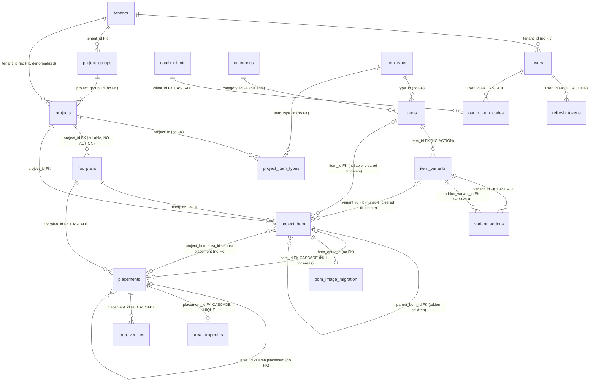

# 05 — SnapFlow 1 Database Schema (source for the Go + Postgres data migration)

Repo: `/home/michael/Projects/github/kingkill85/snap-flow` (branch `main`, HEAD `6d951f2`).
All paths below are relative to `backend/`.

## Summary

- **Engine:** SQLite file, opened through the Deno `sqlite` module (`src/config/database.ts`). It is a single connection singleton with `PRAGMA foreign_keys = ON` set on open. Path = `DATABASE_URL` (default `./data/database.sqlite`). It is resolved against the **process CWD**, not the backend root (`src/config/env.ts`). In Docker that is `/app/backend/data/database.sqlite` on volume `snapflow_data`.
- **Schema source of truth:** an inline array of 38 migrations in `src/scripts/migrate.ts`, applied on every server start (`src/main.ts:263`) and tracked by **name** in the table `migrations`. The `.sql` and `.ts` files in `backend/migrations/` are partial historical copies that are **not executed**. One table, `bom_image_migration`, is created outside the migration system at startup (`src/services/bom-image-migration.ts:21`).
- **Verified final schema:** I replayed all 38 migrations into an in-memory SQLite 3.51 with FKs on, the same way the runner does, and dumped `sqlite_master` plus `PRAGMA foreign_key_list`. The DDL in this document is that verified output.
- **20 application tables:** `tenants`, `users`, `refresh_tokens`, `oauth_clients`, `oauth_auth_codes`, `categories`, `item_types`, `items`, `item_variants`, `variant_addons`, `project_groups`, `projects`, `project_item_types`, `floorplans`, `project_bom`, `placements`, `area_properties`, `area_vertices`, `app_settings`, `bom_image_migration`. On top of these are the bookkeeping tables `migrations` and `sqlite_sequence`.
- **No `deleted_at` columns anywhere.** "Soft delete" is `is_active` (tenants, users, categories, item_types, items, item_variants). Everything else is hard-deleted, with the cascades done by hand in the repositories.
- **Weak schema:** many references have no FK at all (e.g. `projects.project_group_id`, `projects.tenant_id`, `users.tenant_id`, `items.type_id`, `placements.area_id`, `project_bom.area_id`, all of `project_item_types`). Several uniqueness rules exist only in application code. The intended unique index on `(project_group_id, version_name)` from migration 034 was **silently lost** in migrations 036 and 037.
- **Money** is SQLite `REAL` (float), implicitly USD. **Timestamps** are TEXT, written in two formats: `YYYY-MM-DD HH:MM:SS` UTC from `CURRENT_TIMESTAMP`, and ISO-8601 with `Z` from JS `toISOString()`. **Booleans** are 0/1 integers.
- **Files** live under `UPLOAD_DIR` (default `./uploads`, resolved relative to `backend/`; Docker volume `snapflow_uploads` → `/app/backend/uploads`). The DB stores **relative paths** such as `floorplans/…`, `items/…`, `items/excel-import/…` and `projects/<project_id>/bom-images/<bom_id>-<name>`. The files are served at `/uploads/<relative path>`.

## Entity-relationship overview

Solid lines are FKs declared in SQLite. Lines labelled `(no FK)` are references the code relies on that the schema does not enforce.

## Tables

Conventions used in the column tables:
- **PK AI** = `INTEGER PRIMARY KEY AUTOINCREMENT`. Ids are therefore never reused, and `sqlite_sequence` holds the high-water mark. Carry those values over to the Postgres sequences with `setval`.
- **Null?** is "Y" if the column is nullable in the schema.
- **Code** says whether the application actually sets the column.

### tenants
DDL source: migration `031_multi_tenancy`. Repository: `src/repositories/tenant.ts`. Model: `src/models/index.ts` (`Tenant`).

| Column | Type | Null? | Default | Notes |
|---|---|---|---|---|
| id | INTEGER PK AI | N | | Id 1 is seeded by migration 031 as `'Distributor'`, `is_distributor=1` |
| name | TEXT | N | | **UNIQUE** (`idx_tenants_name`) |
| is_distributor | INTEGER | N | 0 | Boolean 0/1. The code assumes exactly one distributor (`findDistributor` takes the first row). Distributor tenants cannot be deleted (`routes/tenants.ts:79`) |
| is_active | INTEGER | N | 1 | Boolean 0/1. Used as a soft delete |
| created_at | DATETIME(TEXT) | Y | CURRENT_TIMESTAMP | UTC `YYYY-MM-DD HH:MM:SS` |

Delete: `routes/tenants.ts` refuses if the tenant has projects. Otherwise it hard-deletes the tenant's users and then the tenant. `project_groups.tenant_id` is a NO ACTION FK, so a tenant that still has groups fails with an FK error.

### users
DDL source: `031_multi_tenancy`, which rebuilt the table created in `001` and extended in `008`. Repository: `src/repositories/user.ts`.

| Column | Type | Null? | Default | Notes |
|---|---|---|---|---|
| id | INTEGER PK AI | N | | |
| email | TEXT | N | | **UNIQUE** (column constraint), plus the redundant index `idx_users_email`. Case-sensitive in SQLite, so Postgres `citext` or `lower()` could expose case duplicates |
| password_hash | TEXT | N | | bcrypt, cost 10 (`src/services/password.ts`), `$2a$`/`$2b$` format |
| role | TEXT | N | 'user' | CHECK in (`admin`, `tenant_admin`, `user`) |
| created_at | DATETIME(TEXT) | Y | CURRENT_TIMESTAMP | `seed-admin.ts` writes an ISO string (`…T…Z`) instead |
| full_name | TEXT | Y | | |
| tenant_id | INTEGER | N | 1 | **No FK.** Index `idx_users_tenant` |
| is_active | INTEGER | N | 1 | Boolean 0/1 |

Seeds: on first start, `src/scripts/seed-admin.ts` creates `admin@snapflow.com` with a random password and role `admin`. It omits `tenant_id`, so the default 1 applies. Manual scripts: `create-admin.ts` creates `admin@snapflow.local` / `admin123`; `seed.ts` and `reset-admin.ts` use `admin@snapflow.com` / `admin123`. A production DB may contain any of these accounts.

### refresh_tokens
DDL source: `025_remove_all_cascade_constraints`, a rebuild of `015`. Service: `src/services/refresh-token.ts`.

| Column | Type | Null? | Default | Notes |
|---|---|---|---|---|
| id | INTEGER PK AI | N | | |
| user_id | INTEGER | N | | FK → users(id), **NO ACTION** |
| token_hash | TEXT | N | | **UNIQUE**. Hex SHA-256 of a random base64 token |
| expires_at | DATETIME(TEXT) | N | | Written as **ISO-8601 `Z`** (now + 7 days) |
| revoked_at | DATETIME(TEXT) | Y | | Written as `CURRENT_TIMESTAMP` format |
| created_at | DATETIME(TEXT) | Y | CURRENT_TIMESTAMP | |

Indexes: `idx_refresh_tokens_user(user_id)` and `idx_refresh_tokens_token(token_hash)`, which duplicates the UNIQUE index.

Note: `userRepository.delete` does not delete tokens first. With FKs on, deleting a user who has tokens fails. The cleanup job `cleanupExpiredTokens` compares the ISO strings against `datetime('now')` text, which is a mixed-format string comparison. **Recommendation:** do not migrate this table. Force everyone to log in again.

### oauth_clients
DDL source: `038_oauth_clients`. Repository: `src/repositories/oauth-client.ts`. Used for MCP / OAuth 2.1 dynamic client registration.

| Column | Type | Null? | Default | Notes |
|---|---|---|---|---|
| id | TEXT PK | N | | 32 hex characters generated by the app |
| client_secret | TEXT | Y | | Holds the **hash** of the secret (`hashClientSecret`), despite the column name. NULL for public clients |
| redirect_uris | TEXT | N | | **JSON array of strings**, e.g. `["https://claude.ai/api/mcp/auth_callback"]` |
| client_name | TEXT | Y | | |
| created_at | DATETIME(TEXT) | Y | CURRENT_TIMESTAMP | |

### oauth_auth_codes
DDL source: `038_oauth_clients`. Repository: `src/repositories/oauth-code.ts`.

| Column | Type | Null? | Default | Notes |
|---|---|---|---|---|
| code | TEXT PK | N | | 64 hex characters |
| client_id | TEXT | N | | FK → oauth_clients(id) ON DELETE CASCADE |
| user_id | INTEGER | N | | FK → users(id) ON DELETE CASCADE |
| redirect_uri | TEXT | N | | |
| code_challenge | TEXT | N | | PKCE S256 |
| scope | TEXT | Y | | |
| expires_at | DATETIME(TEXT) | N | | ISO `Z`, TTL 60 s |
| consumed_at | DATETIME(TEXT) | Y | | ISO `Z` |

Indexes: `idx_oauth_codes_expires` and `idx_oauth_codes_client`. These rows are ephemeral. **Do not migrate them.**

### categories
DDL source: `002` plus `016`. Repository: `src/repositories/category.ts`. Categories are global (no tenant).

| Column | Type | Null? | Default | Notes |
|---|---|---|---|---|
| id | INTEGER PK AI | N | | |
| name | TEXT | N | | Not unique in the schema. Excel sync looks categories up by name (`findByName`), so the data is expected to be unique |
| sort_order | INTEGER | Y | 0 | 1-based after `reorder`; new rows get `MAX+1` |
| is_active | BOOLEAN | Y | true (1) | Index `idx_categories_is_active`. Deactivating a category cascades `is_active=0` to its items and their variants **in code** |

Delete: sets `items.category_id = NULL` for the category's items, then deletes the row.

### item_types
DDL source: `032_add_item_types`. Repository: `src/repositories/item-type.ts`. Shown as "Product Types" in the UI; global.

| Column | Type | Null? | Default | Notes |
|---|---|---|---|---|
| id | INTEGER PK AI | N | | Id 1 is seeded as `('Zigbee','ZB','#3b82f6',1)` |
| name | TEXT | N | | **UNIQUE** |
| abbreviation | TEXT | N | | |
| color | TEXT | N | '#3b82f6' | Hex colour string |
| sort_order | INTEGER | N | 1 | |
| is_active | INTEGER | N | 1 | Boolean |
| created_at | DATETIME(TEXT) | Y | CURRENT_TIMESTAMP | |

Delete is refused while any item has this `type_id`. That check is enforced in code only.

### items  (UI: "Products")
DDL source: `013_make_items_columns_nullable` (rebuild) plus `016` and `032`. Repository: `src/repositories/item.ts`.

| Column | Type | Null? | Default | Notes |
|---|---|---|---|---|
| id | INTEGER PK AI | N | | |
| category_id | INTEGER | Y | | FK → categories(id), NO ACTION. NULL means uncategorized |
| name | TEXT | N | | |
| description | TEXT | Y | | |
| model_number | TEXT | Y | | **LEGACY**: no code reads or writes it since variants were introduced (009/011). Expect NULL or stale values |
| dimensions | TEXT | Y | | Free text (e.g. "86x86x10mm") |
| price | REAL | Y | 0 | **LEGACY**: price now lives on `item_variants.price` |
| image_path | TEXT | Y | | **LEGACY**: images now live on `item_variants.image_path` |
| created_at | DATETIME(TEXT) | Y | CURRENT_TIMESTAMP | |
| base_model_number | TEXT | Y | | **Business key for Excel sync** (`findByBaseModelNumber`, `deactivateMissingForType`). **Not unique** in the schema. Index `idx_items_base_model` |
| is_active | BOOLEAN | Y | true | Index `idx_items_is_active`. Deactivating an item cascades to its variants in code |
| type_id | INTEGER | Y | 1 | → item_types(id), **no FK**. `findOrCreateByBaseModelNumber` can write **`0`** when no type is given (`item.ts`, `typeId ?? 0`), which is a dangling reference |

Hard delete (`ItemRepository.delete`, in a transaction):
1. Set `project_bom.item_id = NULL`.
2. For each variant: set `project_bom.variant_id = NULL` and delete the `variant_addons` rows on both sides.
3. Delete the variants, then the item.

### item_variants  (UI: "Styles")
DDL source: `025_remove_all_cascade_constraints` (rebuild of `009`, plus `016`). Repository: `src/repositories/item-variant.ts`.

| Column | Type | Null? | Default | Notes |
|---|---|---|---|---|
| id | INTEGER PK AI | N | | |
| item_id | INTEGER | N | | FK → items(id), NO ACTION. Index `idx_item_variants_item` |
| style_name | TEXT | N | | Excel sync matches variants case-insensitively on `(item_id, lower(style_name))`. No unique constraint |
| model_number | TEXT | Y | | **LEGACY / unused**: never selected or written by the repository |
| price | REAL | N | | Unit price in **USD**, stored as a float |
| image_path | TEXT | Y | | Relative upload path (`items/…` or `items/excel-import/imageN.ext`). Several variants can share one file |
| sort_order | INTEGER | Y | 0 | Display order inside the item; `reorder` writes 1..n. Order by `(sort_order, id)` |
| created_at | DATETIME(TEXT) | Y | CURRENT_TIMESTAMP | |
| is_active | BOOLEAN | Y | true | Index `idx_item_variants_is_active` |

### variant_addons
DDL source: `014_create_variant_addons_table`. Repository: `src/repositories/variant-addon.ts`.

| Column | Type | Null? | Default | Notes |
|---|---|---|---|---|
| id | INTEGER PK AI | N | | |
| variant_id | INTEGER | N | | FK → item_variants(id) **ON DELETE CASCADE**. This is the parent variant |
| addon_variant_id | INTEGER | N | | FK → item_variants(id) **ON DELETE CASCADE**. This is the add-on variant |
| is_optional | BOOLEAN | N | true | **Inverted** in the API: `is_required = !is_optional`. Only required add-ons are auto-added to the BOM |
| sort_order | INTEGER | Y | 0 | |
| created_at | DATETIME(TEXT) | Y | CURRENT_TIMESTAMP | |

Indexes: `idx_variant_addons_variant` and `idx_variant_addons_addon`. There is no unique constraint on `(variant_id, addon_variant_id)`; it is enforced only by `addAddonIfNotExists`.

### project_groups  (the "project" / customer as the user sees it)
DDL source: `035_remove_project_group_name` (rebuild) plus `036` (status) and `037` (invoice settings). Repository: `src/repositories/project-group.ts`. Model: `src/models/project-group.ts`.

| Column | Type | Null? | Default | Notes |
|---|---|---|---|---|
| id | INTEGER PK AI | N | | |
| customer_name | TEXT | N | | Customer data is embedded here; there is no customers table |
| customer_email | TEXT | Y | | Empty strings are normalised to NULL on create but **not** on update |
| customer_phone | TEXT | Y | | |
| customer_address | TEXT | Y | | Free text, may contain newlines |
| tenant_id | INTEGER | N | | FK → tenants(id), NO ACTION. No index |
| created_at | DATETIME(TEXT) | Y | CURRENT_TIMESTAMP | |
| status | TEXT | N | 'active' | CHECK in (`active`, `completed`, `cancelled`) |
| discount_percentage | REAL | Y | 0 | **Informational only.** The invoice uses `discount_usd`; the percentage is just a UI helper (`services/invoice-calculation.ts`) |
| discount_usd | REAL | Y | 0 | Absolute discount in USD; may be negative |
| services_percentage | REAL | Y | 0 | Informational only, like the discount percentage |
| services_usd | REAL | Y | 0 | Absolute services charge in USD; may be negative |
| local_currency_code | TEXT | Y | NULL | 3-letter ISO code, validated by zod on update. Older rows were back-filled from projects, where `028` had defaulted it to `'PKR'`. New groups get NULL |
| exchange_rate | REAL | Y | 1.0 | Local units per 1 USD. `grandTotalLocal = grandTotalUsd * exchange_rate` |

There are no unique constraints. The `UNIQUE(name, customer_name, tenant_id)` from 033 disappeared together with `name` in 035.

### projects  (UI: a "version" of a project group)
DDL source: `037_move_invoice_settings_to_groups`, the last of four rebuilds (018, 033, 036, 037). Repository: `src/repositories/project.ts`.

| Column | Type | Null? | Default | Notes |
|---|---|---|---|---|
| id | INTEGER PK AI | N | | Referenced everywhere as `project_id`; the UI and MCP call it `version_id` |
| project_group_id | INTEGER | N | | → project_groups(id), **no FK**. Index `idx_projects_group` |
| version_name | TEXT | N | 'v1' | Should be unique per group. **The unique index `idx_projects_group_version` from 034 was dropped by the 036/037 table rebuilds.** Uniqueness is now checked only in `routes/project-groups.ts:186` (create version), not on rename (`PUT /projects/:id`) |
| tenant_id | INTEGER | N | | **Denormalized copy** of the group's tenant, **no FK**. Index `idx_projects_tenant`. All tenant isolation queries filter on this column |
| google_exchange_rate | REAL | Y | 1.0 | **Vestigial**: never written except when copied in `createVersion`, never read for calculations |
| created_at | DATETIME(TEXT) | Y | CURRENT_TIMESTAMP | Used to order versions ("latest version" = MAX `created_at`) |

### project_item_types
DDL source: `032_add_item_types`. Repository: `ProjectRepository.getItemTypeIds/setItemTypeIds/setDefaultItemTypes`.

| Column | Type | Null? | Default | Notes |
|---|---|---|---|---|
| project_id | INTEGER | N | | → projects(id), **no FK** |
| item_type_id | INTEGER | N | | → item_types(id), **no FK** |

PK `(project_id, item_type_id)`. These are the product types enabled for a version; they restrict the catalog in the configurator. New projects get all active types by default. Rows are hard-deleted with the project. Nothing removes them when an item type is deleted, but deletion is blocked only for types that still have items, so orphan rows are possible.

### floorplans
DDL source: `006_create_floorplans_table`, never altered. Repository: `src/repositories/floorplan.ts`.

| Column | Type | Null? | Default | Notes |
|---|---|---|---|---|
| id | INTEGER PK AI | N | | |
| project_id | INTEGER | **Y** | | FK → projects(id), NO ACTION. Always set by the code; make it NOT NULL in Postgres after checking. Index `idx_floorplans_project` |
| name | TEXT | N | | |
| image_path | TEXT | N | | `floorplans/<ms-timestamp>-<rand6>.<ext>` |
| sort_order | INTEGER | Y | 0 | New rows get `MAX+1` within the project; reorder writes 1..n. Order by `(sort_order, id)` |

There is no `created_at` column.

### project_bom  (BOM entries, frozen snapshots)
DDL source: `026_allow_null_item_id_in_project_bom` (rebuild) plus `030` (`area_id`) and `032` (`item_type_name`). Repository: `src/repositories/bom-entry.ts`. Service: `src/services/bom.ts`.

| Column | Type | Null? | Default | Notes |
|---|---|---|---|---|
| id | INTEGER PK AI | N | | |
| project_id | INTEGER | N | | FK → projects(id), NO ACTION. Index `idx_project_bom_project`. Redundant with `floorplan.project_id` |
| floorplan_id | INTEGER | N | | FK → floorplans(id), NO ACTION. Index `idx_project_bom_floorplan`. **The code treats it as nullable** (`project.ts` looks for `floorplan_id IS NULL` rows), but the schema forbids NULL |
| item_id | INTEGER | Y | | FK → items(id). Set to NULL when the catalog item is deleted. Reference for "Update from Catalog" |
| variant_id | INTEGER | Y | | FK → item_variants(id). Set to NULL when the variant is deleted |
| parent_bom_id | INTEGER | Y | | FK → project_bom(id), NO ACTION. NULL = main entry; set = add-on child of a main entry. Only one level deep |
| item_name | TEXT | N | | Snapshot of `items.name` |
| style_name | TEXT | Y | | Snapshot of `item_variants.style_name` |
| model_number | TEXT | Y | | Snapshot of `items.base_model_number`. Falls back to `style_name` for main entries and to `''` for add-ons |
| unit_price | REAL | N | | Snapshot of the variant price in USD (float) |
| picture_path | TEXT | Y | | Snapshot image path, normally `projects/<project_id>/bom-images/<bom_id>-<orig>`. Legacy or failed copies may still point at `items/…` (see File storage) |
| created_at | DATETIME(TEXT) | Y | CURRENT_TIMESTAMP | |
| updated_at | DATETIME(TEXT) | Y | CURRENT_TIMESTAMP | Updated by `BomEntryRepository.update` |
| area_id | INTEGER | Y | | → `placements.id` of a `type='area'` placement, **no FK**. Denormalized from the entry's placement (`AreaRepository.recheckContainment`) |
| item_type_name | TEXT | Y | | Snapshot of `item_types.name`. Back-filled to `'Zigbee'` for pre-032 rows |

Other indexes: `idx_project_bom_parent`, `idx_project_bom_item`, `idx_project_bom_variant`, and the partial index `idx_project_bom_floorplan_variant (floorplan_id, variant_id) WHERE parent_bom_id IS NULL`, which is **not unique** since `025_allow_multiple…`.

How quantity and price work:
- Quantity = number of `placements` rows with `bom_id = main.id`.
- Group total = `main.unit_price * qty + Σ(child.unit_price) * qty` (`services/bom.ts:576`).
- Child add-on entries have **no placements of their own**.

### placements  (devices and areas on a floorplan canvas)
DDL source: `030_create_areas` (rebuild). Repositories: `src/repositories/placement.ts` and `src/repositories/area.ts`.

| Column | Type | Null? | Default | Notes |
|---|---|---|---|---|
| id | INTEGER PK AI | N | | For areas this id **is** the area id used by the API and by `area_id` references |
| bom_id | INTEGER | Y | | FK → project_bom(id) **ON DELETE CASCADE**. Set for `type='item'`, NULL for `type='area'`. Index `idx_placements_bom` |
| floorplan_id | INTEGER | N | | FK → floorplans(id) **ON DELETE CASCADE**. Index `idx_placements_floorplan` |
| type | TEXT | N | 'item' | `'item'` or `'area'`. **No CHECK constraint.** Index `idx_placements_type` |
| area_id | INTEGER | Y | | For items: the containing area's placement id (**no FK**). Always NULL for areas. Index `idx_placements_area` |
| x | REAL | N | | Canvas coordinates, origin (0,0) at the top-left. Units are image pixels of the stored floorplan image, which is resized to at most 1920 px wide on upload |
| y | REAL | N | | |
| width | REAL | N | | Device icon size; for areas, the bounding box |
| height | REAL | N | | |
| rotation | REAL | N | 0.0 | CHECK `rotation >= 0 AND rotation < 360` (degrees). Areas always have 0 |
| created_at | DATETIME(TEXT) | Y | CURRENT_TIMESTAMP | |

### area_properties
DDL source: `030_create_areas`. Repository: `src/repositories/area.ts`.

| Column | Type | Null? | Default | Notes |
|---|---|---|---|---|
| id | INTEGER PK AI | N | | Not exposed; the API uses `placement_id` as the area id |
| placement_id | INTEGER | N | | **UNIQUE**, FK → placements(id) ON DELETE CASCADE. Index `idx_area_properties_placement` duplicates the unique index |
| name | TEXT | N | 'New Area' | Room name |
| color | TEXT | N | '#3b82f6' | Hex. The code writes `'#3B82F6'` (upper case) by default, so the casing is mixed |
| opacity | REAL | N | 0.1 | The code default is 0.2 |
| created_at | DATETIME(TEXT) | Y | CURRENT_TIMESTAMP | Areas are listed in `created_at` order |
| updated_at | DATETIME(TEXT) | Y | CURRENT_TIMESTAMP | |

### area_vertices
DDL source: `030_create_areas`.

| Column | Type | Null? | Default | Notes |
|---|---|---|---|---|
| id | INTEGER PK AI | N | | Not semantically meaningful; vertices are fully rewritten on every edit |
| placement_id | INTEGER | N | | FK → placements(id) ON DELETE CASCADE. Index `idx_area_vertices_placement` |
| vertex_index | INTEGER | N | | 0..n-1, contiguous, clockwise from the top-left for default rectangles. `UNIQUE(placement_id, vertex_index)` |
| x | REAL | N | | Same canvas coordinate space as placements (absolute, not relative to the bounding box) |
| y | REAL | N | | |

In Postgres this could collapse into a `jsonb`/`point[]` column on the area. Preserve the order by `vertex_index`.

### app_settings
DDL source: `029_add_app_settings`. Repository: `src/repositories/settings.ts`.

| Column | Type | Null? | Default | Notes |
|---|---|---|---|---|
| key | TEXT PK | N | | Only known key: `last_sync_timestamp` |
| value | TEXT | N | | `last_sync_timestamp` holds JS `Date.now()` milliseconds **as a decimal string** (seeded `'0'`). It is used only to cache-bust image URLs after an Excel sync |
| updated_at | DATETIME(TEXT) | Y | CURRENT_TIMESTAMP | |

### bom_image_migration  (created at startup, not by a migration)
DDL source: `src/services/bom-image-migration.ts:21`. This is internal bookkeeping for the one-time job that moved BOM pictures from `items/` into per-project folders.

| Column | Type | Null? | Default | Notes |
|---|---|---|---|---|
| id | INTEGER PK | N | | Not AUTOINCREMENT |
| bom_entry_id | INTEGER | N | | UNIQUE, → project_bom(id) (no FK; stale after BOM deletes) |
| old_picture_path / new_picture_path | TEXT | Y | | |
| migrated_at | DATETIME(TEXT) | Y | CURRENT_TIMESTAMP | |
| status | TEXT | Y | 'pending' | CHECK in (`pending`, `completed`, `failed`) |

**Do not migrate it.** It is useful only as a diagnostic: `failed` rows mark BOM entries whose picture still points at a catalog path or a missing file.

### migrations (bookkeeping)
Columns: `id` PK AI, `name` TEXT UNIQUE NOT NULL, `applied_at` DATETIME default CURRENT_TIMESTAMP. **Do not migrate.** Check it on the production DB to confirm that all 38 names are present.

## File storage

- **Root:** `env.UPLOAD_DIR`, default `./uploads`, resolved relative to `backend/` (`src/config/env.ts`, `resolveAbsolutePath`). In Docker it is `/app/backend/uploads`, the volume `snapflow_uploads`.
- **What the DB stores:** paths **relative to the root**, with no leading slash and no `/uploads/` prefix. They are served by `GET /uploads/*` (`src/main.ts:146`) with path-traversal protection, `Cache-Control: immutable` and an ETag built from mtime and size.
- **Writer:** `src/services/file-storage.ts`.
  - `saveFile` names files `<Date.now()>-<6 random base36 chars>.<original extension>` inside the given subdirectory.
  - `copyFile(src, destDir, name?)` **returns the source path unchanged if the source is missing or the copy fails.** This is why some rows still reference shared catalog files.

Directory layout and how each directory is referenced:

| Directory | Written by | Referenced by | Notes |
|---|---|---|---|
| `floorplans/<ts>-<rand>.<ext>` | `uploadMiddleware('floorplans', {maxImageWidth:1920})` in `routes/floorplans.ts`; `createVersion` copies each floorplan image to a new unique name | `floorplans.image_path` | Each floorplan row owns its file (copied per version). The old file is deleted on replace or delete. jpg, png or webp, resized to at most 1920 px wide |
| `items/<ts>-<rand>.<ext>` | `uploadMiddleware('items', {maxImageWidth:1200})` in `routes/items.ts` (manual variant image upload) | `item_variants.image_path` | Deleted when the variant image is replaced or the variant is deleted |
| `items/excel-import/<imageN.ext>` | Excel sync (`services/excel-sync.ts:460`), which extracts `xl/media/*` from the workbook, resizes to 1200 px and writes using the **original xlsx media filename** (`image1.png`, `image2.jpeg`, …) | `item_variants.image_path`. All variants of an item share the first image of the item group | **Filenames are reused across syncs**, so a later sync overwrites `image1.png` with possibly different content. `app_settings.last_sync_timestamp` exists to cache-bust this. The same path can be shared by many variants |
| `imports/<ts>-<rand>.xlsx` | `uploadMiddleware('imports')` | nothing | Temporary Excel uploads, deleted after processing; leftovers may remain. Do not migrate |
| `projects/<project_id>/bom-images/<bom_id>-<source basename>` | `BomService.copyImageToProject` when a BOM entry is created; `createVersion._copyBomPicture`; the startup job `runBomImageMigration`; the scripts `migrate-bom-images.ts` and `fix-shared-bom-images.ts` | `project_bom.picture_path` | The frozen snapshot image, one file per BOM row. The name embeds **both the project id and the BOM id**; renumbering ids during migration does not break anything as long as the path string is copied verbatim. File deletion is reference-counted against `project_bom.picture_path` |

Legacy and inconsistent picture paths to expect in `project_bom.picture_path`:
- `items/...` or `items/excel-import/...`: the copy failed (`copyFile` fallback) or the row predates the BOM image migration. These files are shared with the catalog and **can be overwritten by the next Excel sync**, so the "frozen" snapshot is not actually frozen.
- Paths whose file is missing on disk. Before `fix-shared-bom-images.ts`, two versions could share one file, and deleting one version unlinked it from under the other.
- `NULL`: the variant had no image, or the copy failed during `createVersion`, which deliberately leaves NULL.

Image formats: only jpg, png and webp are accepted on upload, with magic-byte validation (`utils/magic-bytes.ts`). Images are processed by `services/image-processing.ts`. Excel media may include other formats; those are served as `application/octet-stream`.

## Implicit invariants

Rules the code relies on but the SQLite schema does not enforce. Add these as constraints in Postgres, or validate them during the migration.

1. **Tenant consistency.** `projects.tenant_id` should equal `project_groups.tenant_id` of its group. It is violated by:
   - `createVersion`, which stamps the new version with the **caller's** `tenantId` (`routes/project-groups.ts:191`). When an admin (tenant 1) creates a version in a customer tenant's group, the version lands in tenant 1.
   - `PUT /projects/:id` (admin), which can change `projects.tenant_id` without touching the group.

   Tenant isolation for floorplans, BOM, placements and areas is derived by joining through `projects.tenant_id` (`routes/bom-entries.ts:11`). These tables carry no tenant column. `users.tenant_id` should reference an existing tenant (no FK).
2. **Group and version.**
   - Every `projects.project_group_id` must reference an existing group (no FK).
   - Every group must have at least one version. Deleting the last version is blocked (`project.ts`), and a group is deleted via `deleteAllInGroup` followed by the group delete.
   - `version_name` must be unique per group. This is only enforced on create, and the index was lost.
3. **BOM coherence.**
   - `project_bom.project_id` must equal `floorplans.project_id` of `project_bom.floorplan_id`.
   - An add-on child must have the same `floorplan_id` and `project_id` as its parent, and `parent_bom_id` points only at a main entry (depth 1).
   - Children have no placements.
   - `project_bom.area_id` should equal the `area_id` of that entry's placement, and should reference a `placements` row with `type='area'` on the same floorplan.
4. **Placement typing.**
   - `type='item'` requires `bom_id IS NOT NULL`, the BOM entry on the same floorplan, `parent_bom_id IS NULL` on that entry, and `area_id` either NULL or an area placement on the same floorplan.
   - `type='area'` requires `bom_id IS NULL`, `area_id IS NULL`, `rotation = 0`, exactly one `area_properties` row and at least 3 `area_vertices` rows (4 by default).
   - Item reads use INNER JOIN on `project_bom`, so item placements with a dangling `bom_id` are invisible.
5. **Area geometry.** `placements.x/y/width/height` of an area is the bounding box of its vertices (`updateVertices`). Containment is assigned by the "smallest polygon containing the device centre" rule (`AreaRepository.recheckContainment`). Recompute it after migration, or copy it verbatim.
6. **Sort orders.** `categories`, `item_types` and `item_variants` are 1..n after a reorder but may contain 0 or duplicates from older inserts; `floorplans.sort_order` is per project. Always order with `id` as the tie-breaker. Variants with the lowest `(sort_order, id)` supply the item preview image.
7. **Soft delete via `is_active`.**
   - Deactivating a category cascades to its items and variants; deactivating an item cascades to its variants. Reactivation does **not** cascade.
   - Excel sync deactivates items of a type that are missing from the import (`deactivateMissingForType`).
   - Inactive catalog rows remain referenced by BOM entries. That is expected, because BOM rows are snapshots.
8. **Catalog business keys.** `items.base_model_number` is treated as unique, and so is `(item_id, lower(style_name))` for variants (both used by Excel sync). `categories.name` and `item_types.name` are looked up by name. Only `item_types.name` has a UNIQUE constraint.
9. **Add-on pairs.** `(variant_id, addon_variant_id)` is unique and should satisfy `variant_id <> addon_variant_id`. Neither rule is enforced.
10. **Single distributor tenant.** Id 1 (`'Distributor'`) is assumed to exist: it is the default `users.tenant_id` and is re-seeded in tests. Global admins (`role='admin'`) live there and bypass all tenant filters.
11. **Hard-delete cascades are done in code.** Project/version delete removes placements, BOM, floorplans and `project_item_types`, then files. Floorplan delete removes the item placements and BOM, and the FK cascade removes area placements, properties and vertices. Item and variant delete null out the BOM references. FKs that are `NO ACTION` (e.g. `floorplans.project_id`, `project_bom.*`) would block any delete done out of order.

## Migration risks

1. **Verify the production schema before writing the ETL.**
   - Several migrations drop and recreate tables while `foreign_keys=ON` inside a transaction: 013, 018, 023, 025b, 026, 027, 030 and 031. `PRAGMA foreign_keys=OFF` inside a transaction is a no-op (only 033, 036 and 037 are wrapped correctly by the runner).
   - When I replayed these with data present, `025_remove_all_cascade_constraints` failed with `FOREIGN KEY constraint failed`. The cascading drops would also wipe dependent rows (e.g. placements in 026, `refresh_tokens` in 031).
   - Production evidently got through, probably with empty tables at the time, but the real DDL and data may differ from this document.
   - Run `SELECT name FROM migrations`, `.schema` and `PRAGMA foreign_key_check` on a copy of the production DB first.
2. **Lost unique constraint.** `idx_projects_group_version` (034) no longer exists. Look for duplicate `(project_group_id, version_name)` pairs, which are possible via rename, before adding a Postgres UNIQUE.
3. **Missing FKs mean orphans are likely.** Check for orphans and decide whether to drop or repair them:
   - `projects.project_group_id`, `projects.tenant_id`, `users.tenant_id`
   - `items.type_id`, including the value `0`
   - `project_item_types.*`
   - `placements.area_id`, `project_bom.area_id`
   - `project_bom.parent_bom_id` pointing at deleted rows
   - `bom_image_migration`

   Also check placements whose `bom_id` points at missing BOM rows.
4. **Tenant mismatches** between `projects.tenant_id` and `project_groups.tenant_id` (see invariant 1). Decide which side wins; the group is the more authoritative one. The new schema could drop `projects.tenant_id` entirely.
5. **Money is float.** `item_variants.price`, `project_bom.unit_price`, `project_groups.discount_usd/services_usd/exchange_rate/*_percentage` and the legacy `items.price` are all `REAL`. Convert to `numeric(12,2)` for USD amounts, more scale for exchange rates. Round deliberately and reconcile totals per version before and after. The currency is implicitly USD, and `exchange_rate` means local units per USD.
6. **Timestamps are TEXT in mixed formats.**
   - Formats present: `YYYY-MM-DD HH:MM:SS` (`CURRENT_TIMESTAMP`, UTC, no zone marker) and `YYYY-MM-DDTHH:MM:SS.sssZ` (JS ISO: `refresh_tokens.expires_at`, `oauth_*`, seed-admin `users.created_at`).
   - Parse both as **UTC** into `timestamptz`.
   - Some columns are nullable (`created_at` Y) but always populated. Rows copied by older migrations kept their original values.
   - `floorplans` has no timestamps at all.
7. **Booleans** are stored as 0/1 integers, declared either `BOOLEAN` or `INTEGER`. They map to `boolean`. `variant_addons.is_optional` is the inverse of the API's `is_required`; consider storing `is_required` in v2 and inverting during the migration.
8. **Nullable columns that are always set:**
   - `floorplans.project_id`, `categories.sort_order`, `categories/items/item_variants.is_active`, `items.type_id`, `item_variants.sort_order`, and every `created_at`. Coalesce them and make them NOT NULL.
   - `project_bom.floorplan_id` is the opposite case: NOT NULL in the schema, but the code half-expects NULL.
9. **Legacy or dead columns to drop:** `items.model_number`, `items.price`, `items.image_path`, `item_variants.model_number`, `projects.google_exchange_rate`. Also drop the percentages on `project_groups` if v2 does not need them, since they are informational only.
10. **Values encoded as strings:**
    - `app_settings.value` holds an epoch-ms number as a string.
    - `oauth_clients.redirect_uris` is a JSON array; it is the only JSON-in-text column.
    - `item_types.color` and `area_properties.color` are hex strings in mixed case.
    - `local_currency_code` is a free 3-character code, NULL for newer groups. Older ones may carry the 028 default `'PKR'`.
    - `items.dimensions` is free text.
11. **Images are not reliably frozen.** Some `project_bom.picture_path` values point into `items/` and are shared with the catalog; `items/excel-import/imageN.*` gets overwritten on every sync. Others point at missing files.
    - During the file migration, give every BOM row its own copy of its file (the `fix-shared-bom-images.ts` logic) and record unrecoverable rows.
    - Copy the entire `uploads/` tree, verify that every referenced path exists, and report row ids per table where it does not.
    - Exclude `imports/`.
12. **Shared catalog images.** Many `item_variants` rows can share one `image_path`. If v2 moves to object storage keyed by row, de-duplicate by path or by content hash.
13. **Ids.** All PKs are AUTOINCREMENT. Preserve the ids so that the `projects/<project_id>/bom-images/<bom_id>-…` paths stay meaningful. Then reset the Postgres sequences to `max(id)+1`, or use the `sqlite_sequence` value, whichever is higher.
14. **Case sensitivity.** `users.email` uniqueness is case-sensitive. Check for `lower(email)` collisions before adding a case-insensitive unique. `LIKE` searches in SQLite are case-insensitive for ASCII, so v2 will need `ILIKE`.
15. **Data that should not be migrated:** `refresh_tokens`, `oauth_auth_codes`, `bom_image_migration`, `migrations`. `oauth_clients` is optional: MCP clients can re-register, but migrating them avoids breaking connected Claude clients.
16. **Default and test accounts** may exist in production: `admin@snapflow.com` (seed or reset scripts, possibly with password `admin123`) and `admin@snapflow.local` / `admin123`. Flag them to the owner.
17. **Historical data loss already baked in.**
    - `030_create_areas` copied placements with an INNER JOIN on `project_bom`, so placements without a BOM entry were dropped.
    - `023` dropped `placements.item_variant_id` and `selected_addons`, the latter a JSON-in-text column that no longer exists.
    - `018` folded `customers` into projects (`'Unknown Customer'` default).
    - `033` created groups with suffixed names like `"name (2)"` for duplicates, and `035` then dropped the name. Project and group names prior to 035 are gone; only `customer_name` remains.

## Migration history

One line per step in `src/scripts/migrate.ts`, in execution order. Names are verbatim, because the runner tracks them by string.

1. `001_create_users_table` — users (email UNIQUE, password_hash, role admin|user, created_at); index on email.
2. `002_create_categories_table` — categories (name, sort_order).
3. `003_create_items_table` — items (category_id FK, name, description, model_number, dimensions, price NOT NULL, image_path); index on category.
4. `004_create_customers_table` — customers (name, email, phone, address, created_by FK users).
5. `005_create_projects_table` — projects (customer_id FK, name, status CHECK).
6. `006_create_floorplans_table` — floorplans (project_id FK, name, image_path, sort_order); unchanged since.
7. `007_create_placements_table` — placements (floorplan_id, item_id, x, y, width, height).
8. `008_add_full_name_to_users` — users.full_name.
9. `009_create_item_variants_table` — item_variants (item_id FK CASCADE, style_name, model_number, price, image_path, sort_order).
10. `010_create_item_addons_table` — item_addons (per item, slot 1–4); dropped later in 017.
11. `011_add_base_model_number_to_items` — items.base_model_number plus index.
12. `012_update_placements_for_variants` — placements.item_variant_id and selected_addons (JSON text).
13. `013_make_items_columns_nullable` — rebuild items: price nullable with default 0.
14. `014_create_variant_addons_table` — variant_addons (variant_id/addon_variant_id FK CASCADE, is_optional, sort_order).
15. `015_create_refresh_tokens_table` — refresh_tokens (user_id FK CASCADE, token_hash UNIQUE, expires_at, revoked_at).
16. `016_add_is_active_to_catalog` — is_active on categories, items and item_variants, each indexed.
17. `017_drop_item_addons_table` — drop item_addons.
18. `018_remove_customers_table` — copy customer fields into projects; rebuild projects without customer_id; drop customers.
19. `019_add_unique_project_name_customer` — UNIQUE(projects.name, customer_name).
20. `020_create_floorplan_bom_entries` — per-floorplan BOM with *_snapshot columns and a partial unique index (floorplan_id, variant_id) for main entries.
21. `021_update_placements_for_bom` — placements.bom_entry_id FK.
   - (`022` intentionally absent; `migrations/022_backfill_placements_to_bom.ts` was a standalone backfill script.)
22. `023_rename_bom_add_project` — replace floorplan_bom_entries with project_bom (adds project_id and style_name); rebuild placements as (id, bom_id FK CASCADE, x, y, w, h), dropping item_id, item_variant_id and selected_addons.
23. `024_rename_bom_snapshot_columns` — name_snapshot→item_name, model_number_snapshot→model_number, price_snapshot→unit_price.
24. `025_allow_multiple_bom_entries_per_variant` — drop the BOM unique index; add a non-unique partial index.
25. `025_remove_all_cascade_constraints` — rebuild item_variants, refresh_tokens and placements without ON DELETE CASCADE.
26. `026_allow_null_item_id_in_project_bom` — rebuild project_bom with item_id and variant_id nullable and all FKs NO ACTION.
27. `027_add_placement_rotation` — rebuild placements with rotation REAL CHECK [0,360); bom_id FK CASCADE again.
28. `028_add_invoice_settings_to_projects` — discount/services %/USD, local_currency_code default 'PKR', exchange_rate on projects.
29. `029_add_app_settings` — app_settings key/value; seed last_sync_timestamp='0'.
30. `030_create_areas` — rebuild placements with floorplan_id FK CASCADE, type, area_id (only rows with a BOM survive); project_bom.area_id; area_properties; area_vertices.
31. `031_multi_tenancy` — tenants table plus seed tenant 1 'Distributor'; rebuild users with role admin|tenant_admin|user, tenant_id and is_active; projects.tenant_id; unique (name, customer_name, tenant_id).
32. `032_add_item_types` — item_types plus seed 'Zigbee'; items.type_id default 1; project_bom.item_type_name back-filled 'Zigbee'; project_item_types linking all projects to type 1.
33. `033_project_versioning` — project_groups created from projects (customer data and tenant moved there, duplicates suffixed); projects rebuilt as versions (project_group_id, version_name, status, tenant_id, invoice cols, google_exchange_rate).
34. `034_add_project_version_unique_constraint.sql` — UNIQUE INDEX idx_projects_group_version; **lost again in 036 and 037**.
35. `035_remove_project_group_name.sql` — rebuild project_groups without name, which also drops UNIQUE(name, customer_name, tenant_id).
36. `036_move_status_to_project_groups.sql` — project_groups.status back-filled from the latest version; projects rebuilt without status.
37. `037_move_invoice_settings_to_groups.sql` — invoice settings moved to project_groups (back-filled from the latest version); projects reduced to (id, project_group_id, version_name, tenant_id, google_exchange_rate, created_at).
38. `038_oauth_clients` — oauth_clients and oauth_auth_codes for the remote MCP server.

Outside the runner:
- `bom_image_migration` table plus the startup job `runBomImageMigration` (`src/services/bom-image-migration.ts`), which moves non-`projects/` BOM pictures into `projects/<pid>/bom-images/`.
- Manual scripts: `src/scripts/migrate-bom-images.ts` (same idea) and `src/scripts/fix-shared-bom-images.ts` (dry run by default; `--apply` de-duplicates shared picture files and recovers missing ones from the catalog).
